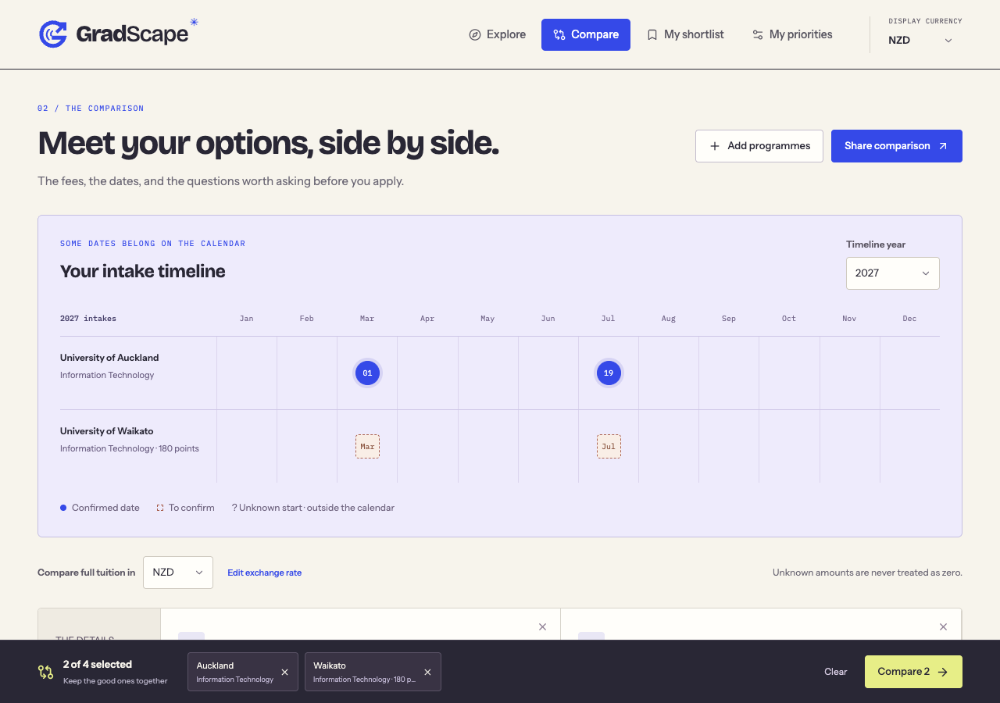

# GradScape

GradScape helps applicants compare international master’s programmes without losing the uncertainty behind a spreadsheet cell. Explore a country, filter by campus and intake, compare two to four pathways on one calendar, and keep a private shortlist with questions for admissions.

**Repository description:** Compare international master’s programmes with transparent tuition, shared intake timelines and device-private shortlists.



## Run locally

Node.js 20.20+ (or 22 LTS), npm, and Python 3 for the one-time workbook importer.

```sh
npm ci
npm run dev
```

Open the Local URL printed by Vite. Use `npm run build` for the static production output in `dist/`, or `npm run preview` to preview it. Fonts are bundled locally; there are no accounts, paid APIs, scraping, live exchange rates or server requirements.

```sh
npm run lint
npm run typecheck
npm test
npm run build
```

Browser tests use local Chrome by default. Set `CHROME_PATH` to a browser executable if installed elsewhere. In two terminals, start `npm run dev -- --port 5175 --strictPort` and `node scripts/preview-subpath.mjs` after building; then run `npm run test:browser`. Tests cover the actual Explore → compare → shortlist flow, notes/status after reload, restore preview, rates, limits, unknown dates, phone/tablet/desktop widths, and direct production navigation at a repository subpath. Test screenshots contain public data only; test notes are never in those screenshots.

## Catalogue and private input

All **27** rows from `Compare courses` were imported, including separate credit pathways. See [the import report](docs/import-report.json). The workbook is private and ignored at `data/import/NZ_Masters_2027_Sortable.xlsx`. Admission judgments, personal fit, contact priority, raw notes and application status are excluded through an explicit column allowlist. No raw note is copied into the catalogue. QS values are excluded because reuse permission is unconfirmed; the app links to the publisher instead.

The initial catalogue contains real workbook records, **not a verified dataset**. Each imported group retains its official source URL with `status: unverified` and `lastVerifiedAt: null`. Six pathway records have additional, narrowly scoped source-check notes covering four official pages; the unreviewed groups remain flagged. Waikato’s two IT pathways have conflicting fee figures. Dates from the workbook are tentative unless separately checked. The published Auckland IT starts and entry information were checked; Canterbury’s NZD 59,400 full fee was checked. These are recorded in [source checks](data/source-checks.json), including scope and check date, and surfaced in programme details.

Many fee years, durations, entry requirements and deadlines still need checking. Generic “ask admissions” prompts are not entry assessments. AUT and other levy-inclusive workbook quotes retain their basis and remain unverified; they are not presented as pure tuition with a known compulsory-fee breakdown. SIT’s award-inclusive quote is marked **partial** and excluded from comparable full tuition. Scholarships are never silently deducted. No immigration or settlement comparisons are included.

### One-time original workbook import

```sh
# Expected private input: data/import/NZ_Masters_2027_Sortable.xlsx
npm run import:nz
npm run catalogue:preview -- data/import/catalogue.csv
npm run catalogue:write -- data/import/catalogue.csv
npm run catalogue:export -- data/import/catalogue-editable.csv
```

The importer only extracts allowed public fields, checks the sheet and 27-row expectation, and produces a private CSV starting copy. It never writes the catalogue. The immutable source-URL + credit mapping in `scripts/nz-row-ids.json` survives row sorting, title corrections and fee changes. Unknown legacy rows fail rather than receiving an existing ID. Use the ongoing template workflow for new programmes and changed source URLs; never regenerate IDs from titles.

### Ongoing spreadsheet updates

The tracked [blank CSV template](data/catalogue-template.csv) opens in Excel, LibreOffice or Google Sheets. Export the current catalogue first to preserve IDs and avoid unintended removals:

```sh
npm run catalogue:export -- data/import/catalogue-editable.csv
# Edit the CSV in a spreadsheet and save as UTF-8 CSV, preserving date text and IDs.
npm run catalogue:preview -- data/import/catalogue-editable.csv
npm run catalogue:write -- data/import/catalogue-editable.csv
# Review before committing:
git diff -- data/catalogue.json data/source-checks.json
```

Complete loop: **check official programme/calendar/fee/admissions/scholarship page → edit spreadsheet → preview changes → regenerate JSON → review Git diff → commit and redeploy**. The preview reports added, changed, removed and flagged IDs without writing. Validation rejects duplicate IDs, malformed dates/precision, bad source URLs, invalid currencies and fee scopes. Writes are validated first and atomically renamed, with deterministic sorted IDs and indented JSON. Unexpected removals block writes; after reviewing them explicitly, use `npm run catalogue:write -- data/import/catalogue-editable.csv --allow-removals`. Do not use that flag to bypass accidental deletion.

Read [the schema and review rules](docs/catalogue.md) before editing. Check scoped source notes whenever a material fact changes; stale checks must be removed or replaced. The app never marks all facts verified just because a linked page exists. The original workbook importer is a one-time migration; do not rerun it over ongoing edits.

## Privacy, rates and costs

Public comparison selections survive reloads in tab-local session storage. Shortlist notes and statuses, priorities, the display currency and the edited NZD/INR rate are stored in this browser’s `localStorage`. Browser storage can be cleared or unavailable; export the versioned JSON backup. Restore validates every ID, note and status, then previews the replacement before confirmation. Backups contain personal notes: keep them private. Comparison links contain public course IDs only. Different browser origins (including development and production) have separate storage.

The initial **52.9 INR per NZD** rate is a workbook planning reference dated **10 November 2026**, not a live rate. A device-local override updates conversions and budget filters. The header’s Display currency selector is available on every screen and remembers NZD/INR on this device. Selected-currency estimates lead each fee display, with the original quote retained. Switching currencies converts an existing tuition budget and living-cost scenario, preserving their value. The tuition slider uses the country’s full quotes, independently of other filters; an exact numeric input and No maximum reset remain available. Unknown rates never become zero. Full-fee sorting/budgets exclude annual and partial quotes and sort unknown amounts after known ones. The optional living-cost scenario uses a user-entered monthly amount × known duration; it shows separate tuition and living arithmetic and omits a total if tuition, duration or a required rate is missing.

## Deploy to your account

Nothing has been published or pushed. The app uses Vite `base: './'` and hash navigation (`#explore`, `#compare?ids=…`), so assets and direct links work under a GitHub repository subpath without server rewrites. `dist/` is the only public deployment directory; private imports are not copied to it.

**Cloudflare Pages:** connect your own repository, choose `npm run build` as the build command, `dist` as output, and Node 22. No environment variables are required.

**GitHub:** create an empty repository in your account, then run (replace YOUR_USERNAME):

```sh
git remote add origin https://github.com/YOUR_USERNAME/gradscape.git
git push -u origin main
```

For GitHub Pages, enable Settings → Pages → GitHub Actions and use the included workflow. It builds, tests and uploads only `dist/`. Adding a remote, pushing and enabling hosting are your separate actions. The workflow does not include private workbook files or device data.

## First-release verification limits

The software workflow is tested. The catalogue still needs a complete official-source audit, fee/levy separation, exact duration checks for seven pathways, confirmed 2027 intakes and deadlines, country-specific entry-equivalence guidance, and ranking reuse permission. Empty countries are explicitly labelled. Adding another country requires data only; conversion needs a known currency rate, otherwise the original quote is shown and conversion is unavailable.

## GradScape identity

A travel field guide for choosing a master’s: ultramarine, warm paper, citron and vermilion, with Bricolage Grotesque headings, Instrument Sans body text and IBM Plex Mono calendar labels. All fonts ship locally. The original vector G mark combines contour lines with an outward route; the standalone wordmark is `public/gradscape-logo.svg`, and its mark/favicon is `public/gradscape-mark.svg`. The sticky navigation keeps the currency selector available while you research. Storage guidance lives in the footer and shortlist instead of the brand header. Existing shortlist and preference keys are preserved through the rename.
